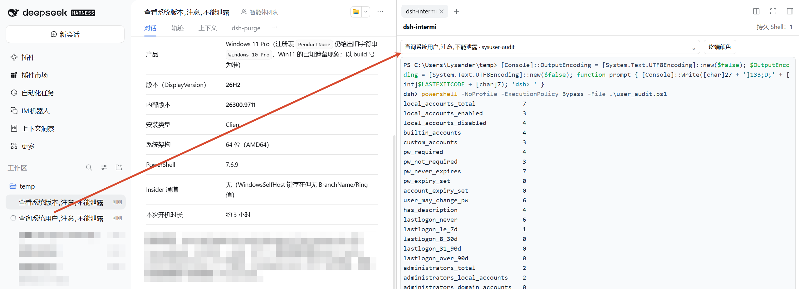
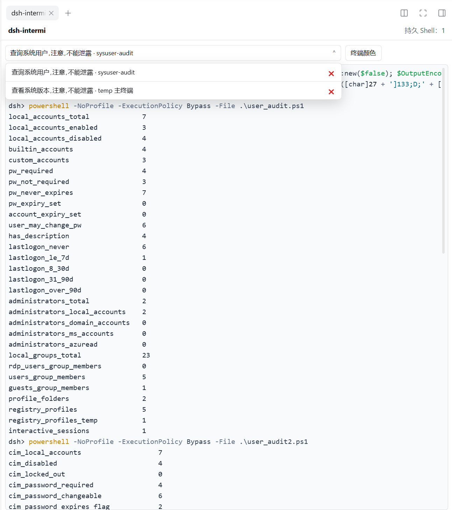

# dsh-intermi

**See and use the exact terminal your DSH Agent is using.** dsh-intermi puts the Agent's existing persistent shell in DSH NEXT's right sidebar, so you can follow its work and step in when needed.

[简体中文](README.zh-CN.md) · English

## Screenshots

View an Agent's live persistent terminal beside its conversation:



The terminal selector uses concise names. Open it to switch shells or delete one from its row:



## Why dsh-intermi?

Most terminal views show a separate shell. dsh-intermi attaches to the PTY already owned by the Agent: one session, one live stream, shared between you and the Agent.

- **Watch live work** — follow terminal input and output as the Agent works.
- **Switch between Agents** — choose a session by its DSH conversation title without closing other shells.
- **Take over when needed** — focus the terminal and type into the same shell. Press `Ctrl+C` to interrupt the foreground command; the Agent can continue in that shell.
- **Keep the full output** — PTY output is saved locally without a rolling disk limit. The visible scrollback has a memory-conscious default of 50,000 lines, adjustable from 5,000 to 100,000 in Terminal display settings.
- **Clean up in one step** — use **Clear all terminals** to end all remaining PTYs and remove their saved output. The confirmation shows how many terminals will be affected; command audit events remain stored locally.
- **Keep Agent results scoped to the command** — the DSH tool response contains only the result of its current `terminal_send`; full terminal history stays in the ITMN view for the user. If DSH returns no output, dsh-intermi recovers only a provable current-command delta or reports uncertainty. It never calls `terminal_read` for the Agent or resends the command. This is a tool-response boundary, not OS-level isolation: an Agent shell runs as the same user and may be able to read local files if explicitly instructed to do so.
- **Make it readable** — choose a light or dark theme, or set custom foreground and background colors.

## Install

In DSH NEXT's Plugin Market, install **dsh-intermi** from GitHub:

[`Lysander-9/dsh-intermi`](https://github.com/Lysander-9/dsh-intermi)

If the market asks for a repository URL, use:

```text
https://github.com/Lysander-9/dsh-intermi.git
```

Restart DSH NEXT if the market prompts you to do so, then open **dsh-intermi** in the right sidebar.

## Get started

1. Start or select an Agent conversation.
2. Let the Agent run a terminal task. dsh-intermi directs its shell work to that Agent's persistent DSH terminal.
3. Select the conversation from the terminal selector. The terminal displays that Agent's live PTY.
4. Click inside the terminal to type. Use `Ctrl+C` to stop a foreground command without closing the shell.

A terminal appears after the Agent opens its persistent shell. Switching the selector only changes which shell you are viewing; other shells keep running.

## Shells and saved output

- Each Agent conversation has its own persistent shell. dsh-intermi does not create a second, look-alike terminal.
- Closing or switching the sidebar view disconnects the view; it does not close the shell.
- Deleting a shell closes its PTY and running processes, and removes that shell's saved terminal output. Command audit events—including recorded tool input and result—remain stored locally in `events.jsonl`.
- **Clear all terminals** applies the same cleanup to every live and archived terminal shown by the selector.
- dsh-intermi appends observed PTY output to a local per-shell log and replays it when you reopen the view. Logs have no rolling disk cap and use local disk space until the shell is deleted. The in-memory scrollback defaults to 50,000 lines; change it from **Terminal display** settings (5,000–100,000 lines). Exiting DSH NEXT ends running PTY processes; the saved output remains available for read-only review, but the process itself does not resume after restart.
- Terminal history and command events are stored locally in DSH home, under `itatmn/` (`events.jsonl` contains command events).
- To keep shell work attached to the audited PTY, standalone `pwsh`, `bash`, and `ops_bash` shell tools are blocked while dsh-intermi is active.

## Requirements

- DSH NEXT `>= 0.2.1-rc.2` and `< 0.3.0`
- A DSH Agent with access to the native persistent terminal tools

## Development and acknowledgements

The Host entry is `lib/index.js`; the right-sidebar client is `lib/client.js`. The browser terminal uses vendored xterm.js assets. See [THIRD_PARTY_NOTICES.md](THIRD_PARTY_NOTICES.md) for attribution and license details.

## License

The package currently declares `UNLICENSED` in its manifest.
